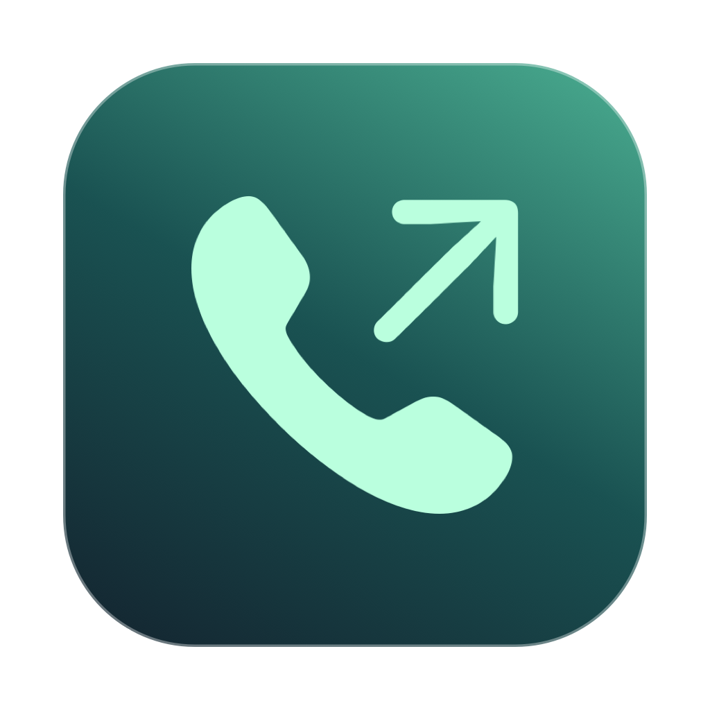
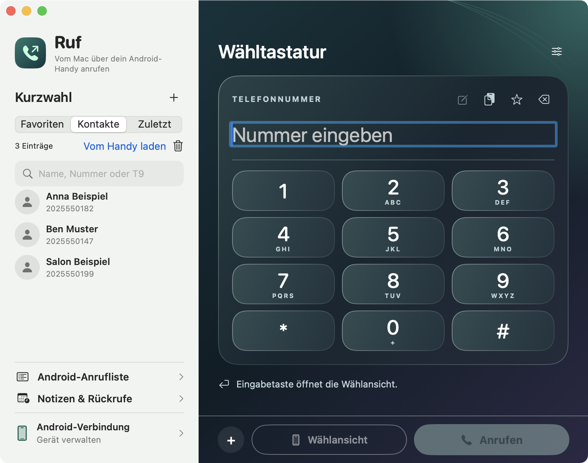

<h1 align="center">Ruf</h1>

<strong>Vom Mac über dein Android-Handy anrufen</strong>

  <a href="https://github.com/Supersynergy/ruf/releases/latest"><strong>Download für macOS</strong></a> ·
  <a href="#erster-anruf">Erster Anruf</a> ·
  <a href="docs/ANLEITUNG.md">Anleitung</a> ·
  <a href="CHANGELOG.md">Versionsverlauf</a>

Klicke am Mac auf eine Telefonnummer in Mail oder im CRM. Ruf übernimmt sie ins Wählfeld. Mit **Anrufen** wählt dein Android-Handy über seinen Mobilfunkanschluss. Du sprichst am Handy oder über dessen Headset.

**macOS 13 oder neuer** · Apple Silicon und Intel · Deutsch und Englisch

## Erster Anruf

1. Melde dich mit dem GitHub-Konto an, das Zugriff auf dieses private Repository hat. Lade das Disk-Image aus dem [aktuellen Release](https://github.com/Supersynergy/ruf/releases/latest) und ziehe **Ruf (Supersynergy)** nach **Programme**. Die App ist ad hoc signiert. Da eine Apple-Notarisierung fehlt, kann macOS beim ersten Start eine [Bestätigung für Ruf](docs/ANLEITUNG.md#wenn-macos-den-entwickler-nicht-bestätigen-kann) verlangen.
2. Entpacke die [Android SDK Platform-Tools für Mac](https://developer.android.com/tools/releases/platform-tools). Öffne links unten **Android-Verbindung** in Ruf und wähle den entpackten Ordner.
3. Aktiviere USB-Debugging auf dem Handy, verbinde es per USB und bestätige die Verbindung auf dem entsperrten Gerät.
4. Tippe eine Nummer ein. **Wählansicht** zeigt sie auf dem Handy zur Kontrolle. **Anrufen** startet den Anruf. Für Links aus Mail oder CRM wähle unter **Android-Verbindung** einmal **Für Telefonlinks als Standard setzen**.

## Ein klarer Ablauf

1. **Kontakt finden:** Telefonbuch vom Handy laden, Favoriten nutzen oder eine Nummer aus Mail oder CRM übernehmen.
2. **Bewusst wählen:** **Wählansicht** beziehungsweise Return öffnet die Nummer auf dem Handy. Erst **Anrufen** startet das Gespräch.
3. **Im Gespräch steuern:** Die Gesprächsleiste erscheint nur bei einem Anruf. Annehmen, Ablehnen und Auflegen stehen dort; im Gespräch kommen Mikrofon, Lautsprecher, Halten und Tonwahl hinzu, soweit Android sie unterstützt.
4. **Danach nachfassen:** Notiz speichern und bei Bedarf einen Rückruf planen. **Heute zurückrufen** bündelt fällige Zusagen und abgeglichene verpasste Anrufe.

Ohne Gespräch gibt es keine rote Auflegen-Taste und keine leere Gesprächsleiste. Verbindung und Einrichtung liegen an einer Stelle: **Android-Verbindung** links unten. Das Reglersymbol neben **Wähltastatur** öffnet Telefonsteuerung, Android-Helfer und das freiwillige SynergyCoder-Plugin.

## Im Arbeitsalltag

| Wenn du … | In Ruf |
| --- | --- |
| einen Kontakt oft anrufst | Speichere ihn in der **Kurzwahl**. Die Suche versteht Namen, Nummern und T9-Ziffern. |
| nach einem Gespräch etwas festhalten willst | Trage unter **Notizen & Rückrufe** Ergebnis und nächsten Termin ein. Eine einzelne Notiz kannst du ins CRM kopieren. |
| einen verpassten Anruf zurückgeben willst | Aktiviere die **Android-Anrufliste** für dieses Handy. Wähle **Verpasst** und übernimm die Nummer oder plane den Rückruf. |

Der Abgleich ist pro Handy freiwillig. Wie oft Ruf die Anrufliste liest, welche Daten lokal bleiben und wie der Export aufs Handy funktioniert, steht in der [Anleitung](docs/ANLEITUNG.md#anrufliste-und-gesprächsnotizen).

## Kontaktbilder und Zugriff

Ein Klick auf ein Kontaktbild öffnet den Fotoeditor. Ein eigenes Bild bleibt zunächst auf dem Mac. Import vom Handy und Übertragen auf das Handy sind getrennte Aktionen; das Ersetzen auf Android verlangt eine Bestätigung. Fehlende Bilder während eines Anrufs automatisch zu laden ist freiwillig und pro Handy schaltbar.

Für Mikrofonsteuerung und weitere Gesprächsaktionen braucht Ruf den mitgelieferten Android-Anrufhelfer (Android 10+). Er wird erst nach deiner Bestätigung installiert. Kontaktberechtigungen für Bilder sind separat; Zugriff lässt sich wieder entziehen. Ruf überträgt kein Gesprächsaudio an den Mac.

## Updates und Hilfe

Die App hieß früher **Super Mac Android Phone Dialer (SMAPD)** und **PhonePilot Dial**. Schließe die bisherige Version und öffne Ruf aus **Programme**. Favoriten, Gesprächsnotizen und Rückrufe verwenden dieselbe lokale Ablage. Die [Anleitung](docs/ANLEITUNG.md) hilft auch bei mehreren Geräten und beim Prüfen des Downloads.

Für Rückmeldungen gibt es die [privaten Issues](https://github.com/Supersynergy/ruf/issues). Nenne die Ruf-, macOS- und Android-Version sowie den Schritt, an dem es hakt. Verwende für Beispiele fiktive Telefonnummern.

*English:* Ruf is an Android dialer for macOS. Open a phone link or type a number on your Mac, then place the call on your connected Android phone. The disk image includes a setup guide in English and German.

[Herausgeber und Lizenzhinweise](LICENSE.md)
