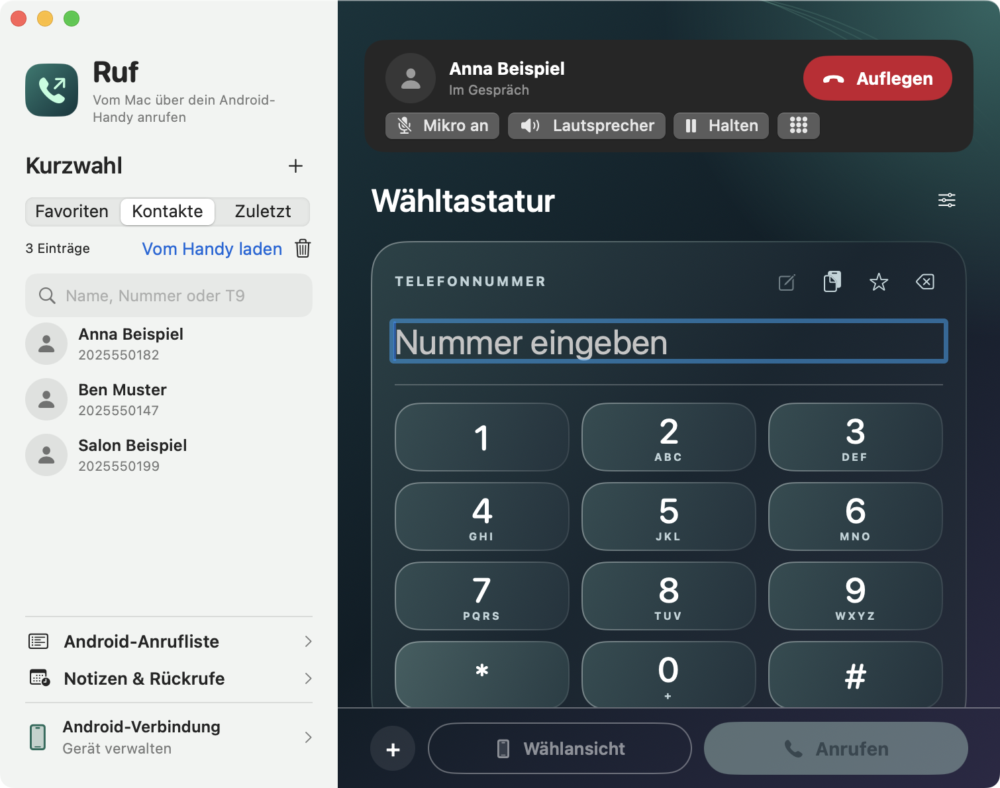

# Ruf einrichten und nutzen

## Download prüfen

Lade das Disk-Image und die Datei `SHA256SUMS.txt` aus demselben privaten Release in einen gemeinsamen Ordner. Wenn du GitHub CLI verwendest, lädt dieser Befehl Version 2.7.2 mit deinem angemeldeten Konto herunter und vergleicht das Disk-Image mit der veröffentlichten Prüfsumme.

```sh
mkdir -p Ruf-2.7.2
gh release download v2.7.2 --repo Supersynergy/ruf --dir Ruf-2.7.2 \
  --pattern '*.dmg' --pattern SHA256SUMS.txt
(cd Ruf-2.7.2 && shasum -a 256 -c SHA256SUMS.txt)
```

Bei Erfolg erscheint hinter dem DMG-Dateinamen `OK`. Öffne das Disk-Image und ziehe **Ruf (Supersynergy)** nach **Programme**. Beim Update schließt du zuerst die bisherige App. Die Paketdatei enthält die App für Intel und Apple Silicon sowie eine zweisprachige Kurzanleitung.

### Wenn macOS den Entwickler nicht bestätigen kann

Ruf ist ad hoc signiert. Wenn du Ruf aus diesem privaten Release geladen hast, dem Herausgeber vertraust und die Prüfsumme stimmt, kannst du den ersten Start ausdrücklich für diese App erlauben. Öffne Ruf zunächst einmal. Wähle anschließend in den **Systemeinstellungen → Datenschutz & Sicherheit** bei Ruf **Dennoch öffnen** und bestätige. Auf einem verwalteten Mac kann deine IT diese Möglichkeit einschränken. [Apple erklärt die Meldungen beim Öffnen einer App](https://support.apple.com/de-de/102445)

## Handy verbinden

Entpacke die Android SDK Platform-Tools auf dem Mac. Wähle in Ruf **Android-Verbindung → Platform-Tools-Ordner wählen …**. Aktiviere USB-Debugging auf dem Handy und bestätige die Verbindungsanfrage auf dem entsperrten Gerät. Unter **Erneut suchen** erscheint es anschließend in der Geräteliste. Bei mehreren Geräten wählst du dort das gewünschte Handy. Ruf kann auch ein Gerät verwenden, das bereits über WLAN mit ADB verbunden ist. [Android SDK Platform-Tools](https://developer.android.com/tools/releases/platform-tools) · [USB-Debugging einrichten](https://developer.android.com/studio/run/device)

## Nummern aus Mail oder CRM

Wähle unter **Android-Verbindung** die Option **Für Telefonlinks als Standard setzen**. Ein Klick auf einen `tel:`-Link lädt die Nummer ins Wählfeld am Mac. **Wählansicht** öffnet sie im Telefonprogramm auf Android. **Anrufen** übergibt den Anruf an das ausgewählte Handy.

## Gespräch steuern

Nur bei einem eingehenden oder laufenden Anruf erscheint oben die Gesprächsleiste. Ohne Anruf bleiben Gesprächsleiste und rote Taste ausgeblendet. Über das Reglersymbol neben **Wähltastatur** öffnest du Telefonsteuerung und Plugins. Dort lässt sich der Android-Anrufhelfer nach Bestätigung auf dem ausgewählten Handy einrichten und sein Zugriff wieder entziehen. Er benötigt Android 10 oder neuer.

Im Gespräch sind je nach Android-Gerät Mikrofon, Lautsprecher, Halten/Fortsetzen und Tonwahl verfügbar. Die Tonwahl öffnet sich als kleines Fenster; Escape schließt es. Cmd-L setzt den Fokus auf die Rufnummer. Return öffnet die Wählansicht, ohne direkt anzurufen.



Kontaktbilder lassen sich lokal auswählen oder nach Berechtigungsfreigabe vom Handy laden. Das Übertragen auf Android ersetzt das Bild erst nach Bestätigung; das Kontaktkonto kann es weiter synchronisieren. Automatisches Laden fehlender Bilder bei Anrufen ist freiwillig und gilt nur für das freigegebene Handy.

## Anrufliste und Gesprächsnotizen

- Unter **Zuletzt** kannst du den lokalen Verlauf leeren und die Speicherung weiterer Nummern ausschalten.
- Wenn du den Abgleich für ein Gerät einschaltest, liest Ruf bei geöffneter App ungefähr einmal pro Minute dessen letzte 100 Anrufe. Manche Geräte sperren den Lesezugriff. Beim Ausschalten entfernt Ruf die lokale Kopie dieses Geräts.
- Notizen und Rückrufe liegen getrennt vom Verlauf auf dem Mac. Im Menü eines Eintrags kannst du eine Notiz fürs CRM in die Zwischenablage kopieren.
- Bestätige in **Notizen & Rückrufe** das Zielgerät und die Zahl der Einträge. Jeder Export ersetzt die lesbare Datei `Documents/SMAPD/Vertriebsjournal.txt` im gemeinsamen Speicher des Handys. Der bisherige Ordnername gilt auch für Ruf.

[Zurück zur Übersicht](../README.md)
